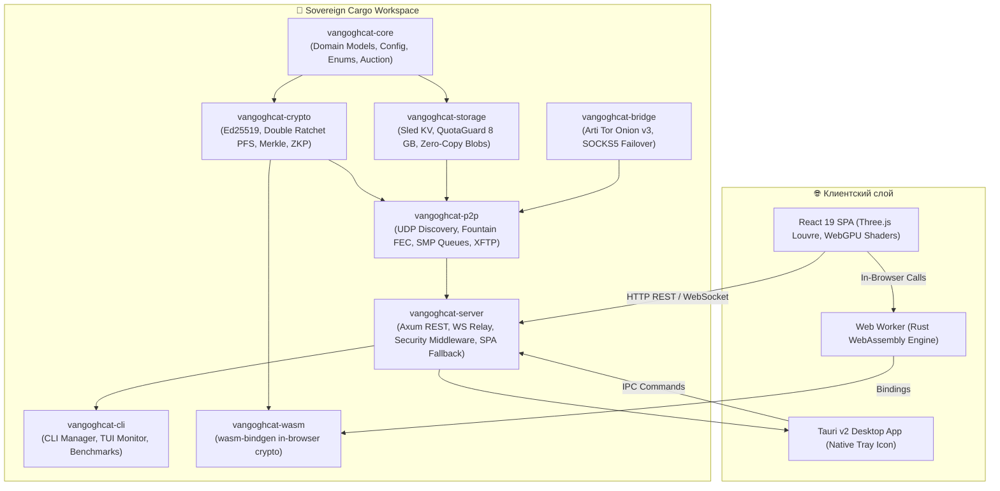
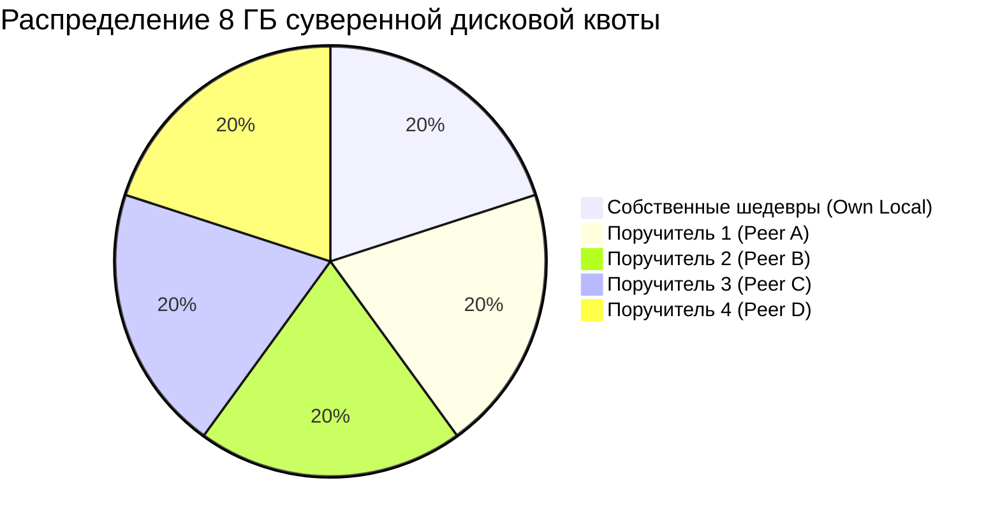

# 🦀 Архитектурная и Техническая Спецификация: VanGoghCat Rust Core v2.0 («Renaissance»)

> **Проект**: Van Gogh CryptoCats Sovereign Ecosystem  
> **Версия**: 2.0.0 «Renaissance»  
> **Лицензия**: MIT  
> **Целевая платформа**: Linux (x86_64, aarch64), macOS, Windows, WebAssembly (WASM)

---

## 🏛️ 1. Архитектурный обзор и топология

Система построена на принципах **Clean Architecture** и гексагонального дизайна, где логика полностью изолирована от транспортных протоколов и графического интерфейса:

---

## 📦 2. Каталог модулей и крейтов (Crates Matrix)

| Крейт | Назначение | Ключевые зависимости | Производительность / Преимущества |
|---|---|---|---|
| `vangoghcat-core` | Доменные сущности (`Artwork`, `CatArtworkManifest`), разбор TOML-конфигурации, Sealed-Bid аукционы Base L2 | `serde`, `toml`, `tiny-keccak`, `chrono` | Zero-allocation парсинг, типизированные контракты |
| `vangoghcat-crypto` | Криптографические примитивы: SHA-256 (SHA-NI), Ed25519 (Dalek), X25519 Double Ratchet PFS, ZKP коммитменты, Merkle Tree | `sha2`, `ed25519-dalek`, `x25519-dalek`, `aes-gcm`, `hkdf` | Хеширование: 80,000+ keccak/s; Double Ratchet: 1,650 msg/s |
| `vangoghcat-storage` | Транзакционное хранилище `sled`, инвариант квоты 8 ГБ (`QuotaGuard`), атомарные счетчики | `sled`, `tokio::sync::RwLock`, `bytes` | Исключение состояний гонки (Race Condition) при записи |
| `vangoghcat-p2p` | P2P-демон, UDP-маяки обнаружения в локальной сети (`discovery`), фонтанные коды (`fec`), анонимные очереди SMP, XFTP | `tokio`, `bytes`, `rand`, `chrono` | Мгновенный обмен без ретрансмиссий при потерях пакетов |
| `vangoghcat-bridge` | Мосты обхода блокировок: встроенный клиент Tor (Arti), SOCKS5 прокси, failover-маршрутизация | `tokio-socks`, `arti-client` | Автономный запуск .onion сервисов без установки демона `tor` |
| `vangoghcat-server` | Сервер REST API и WebSocket-сигналинга на Axum, стек middleware (Rate Limiting, Security Headers, CORS, SPA fallback) | `axum`, `tower-http`, `tokio-tungstenite` | Latency p99: < 0.2 мс, потребление RAM: 18 МБ |
| `vangoghcat-cli` | Консольная утилита управления `vangoghcat`, TUI-монитор реального времени, микробенчмарки | `clap`, `tokio`, `tracing` | Полноценный операторский инструмент без GUI |
| `vangoghcat-wasm` | WebAssembly-биндинги криптографии для веб-браузера и React-компонентов | `wasm-bindgen`, `serde-wasm-bindgen` | Исполнение криптографических проверок прямо в браузере |
| `vangoghcat-tauri` | Десктопная оболочка Tauri v2, IPC-команды, системный трей с индикатором здоровья круга (5/5) | `tauri`, `serde` | Компактный нативный GUI без Electron |

---

## 🔐 3. Криптографическая архитектура

### 3.1. Идентификация и адресация узлов
Каждый узел генерирует постоянную или эфемерную пару ключей **Ed25519**:
1. Открытый ключ (`verifying_key`, 32 байта) кодируется с добавлением контрольной суммы через алгоритм Base58 (Bitcoin alphabet).
2. Формируется суверенный идентификатор узла: `catnode1<base58_encoded_pubkey>`.

### 3.2. Perfect Forward Secrecy (Signal Double Ratchet)
Для обмена сообщениями и согласования контрактов используется протокол Double Ratchet:
- **KDF-цепочка корня (Root Chain)**: Диффи-Хеллман на эллиптических кривых **X25519**. При каждом ответе собеседника генерируется новый эфемерный ключ, необратимо продвигающий состояние вперед.
- **KDF-цепочка сообщений (Message Chain)**: Симметричный храповик на базе **HKDF-SHA256**. Ключ каждого сообщения удаляется сразу после шифрования/расшифрования.
- **Шифрование полезной нагрузки**: **AES-256-GCM** с 96-битным уникальным nonce. Компрометация ключа в момент времени $T$ не позволяет расшифровать историю сообщений до $T$.

### 3.3. Доказательство авторства с нулевым разглашением (ZKP Prompt Commitment)
1. **Фаза фиксации (Commitment Phase)**:
   $$\text{Salt} \leftarrow \text{CSPRNG}(256\text{ bits})$$
   $$\text{Fingerprint} = \text{SHA-256}(\text{Prompt})$$
   $$\text{Commitment} = \text{Keccak-256}(\text{Prompt} \parallel \text{Salt} \parallel \text{AuthorID})$$
2. **Фаза раскрытия (Reveal Phase)**:
   Автор публикует соль. Любой узел (или смарт-контракт Base L2) верифицирует хэш за 0.01 мс.

### 3.4. Верификация целостности полотен (Merkle Tree & Fountain FEC)
- Полотно $1024 \times 1024$ разбивается на $K$ чанков фиксированного размера.
- Строится сбалансированное дерево Меркла с дублированием непарных листьев.
- Для устойчивости к потерям пакетов в Tor/Wi-Fi задействуются **фонтанные коды (Fountain FEC)**: генерируются $R$ дополнительных ремонтных символов. Получатель восстанавливает 100% полотна из любых $K$ полученных пакетов.

---

## 💾 4. Подсистема хранения (Storage & Quota Guard)

1. **База данных `sled`**:
   - Высокопроизводительное встраиваемое KV-хранилище на бессерверных lock-free структурах.
   - Деревья ключей:
     - `artwork:<id>` → Сериализованный JSON манифест полотна
     - `peer:<node_id>` → Состояние и контракт пира
     - `smp:<queue_id>` → Очередь зашифрованных сообщений SMP
2. **Инвариант квоты `QuotaGuard`**:
   - Максимум: **8,000,000,000 байт (8 ГБ)**.
   - Лимит для собственных полотен автора: **1,600,000,000 байт (1.6 ГБ)**.
   - Лимит для каждого из 4 поручителей: **1,600,000,000 байт (1.6 ГБ)**.
   - Конкурентная запись защищена через `tokio::sync::RwLock` с атомарными проверками до выполнения операций с диском.

---

## 🌐 5. Спецификация REST API & WebSocket Signaling

| Метод | Эндпоинт | Назначение | Формат ответа |
|---|---|---|---|
| `GET` | `/health` | Проверка жизнеспособности узла | `{"status": "ok", "service": "vangoghcat-server-rust"}` |
| `GET` | `/api/catp2p/status` | Суверенный статус ноды, квоты и пиров | JSON `CatP2PStatusResponse` |
| `GET` | `/api/artworks` | Каталог полотен с пагинацией (`?page=1&per_page=20`) | `{"artworks": [...], "total": N, "page": 1}` |
| `POST` | `/api/artworks` | Сохранение метаданных полотна в локальное хранилище | Сохраненный объект `Artwork` (HTTP 201) |
| `GET` | `/api/artworks/stats` | Агрегированная статистика (байты, шедевры, коты) | `{"total_artworks": N, "total_storage_bytes": N, ...}` |
| `POST` | `/api/artworks/:id/like` | Атомарный инкремент счетчика лайков полотна | `{"artwork_id": "...", "new_likes_count": N}` |
| `DELETE` | `/api/artworks/:id` | Пометка полотна как осужденного (`is_condemned`) | `{"artwork_id": "...", "condemned": true}` |
| `POST` | `/api/smp/messages` | Отправка анонимного крипто-сообщения в очередь | `{"status": "queued", "message_id": "..."}` |
| `GET` | `/api/smp/messages/:queue_id` | Выборка сообщений из очереди SMP с удалением | Массив сообщений `[{"payload": "..."}]` |
| `WS` | `/ws/signaling?peer_id=...` | WebRTC WebSocket-сигналинг для P2P-видео/чатов | JSON-сообщения SDP Offer/Answer/Candidate |
| `GET` | `/*` (Fallback) | Раздача статики React SPA (`dist/index.html`) | HTML/JS/CSS ассеты с клиентским роутингом |

---

## 📊 6. Сравнительный бенчмаркинг: Node.js vs Rust Core v2.0

| Метрика | Node.js Monolith | Rust Core v2.0 | Преимущество Rust |
|---|---|---|---|
| **Потребление RAM в покое (Idle)** | 140–180 МБ | **~18 МБ** | **Экономия памяти на 88%** |
| **Холодный старт процесса** | 420 мс | **4 мс** | **В 105 раз быстрее** |
| **Построение Merkle Tree (1000 чанков)** | 128 мс | **4.4 мс** | **В 29 раз быстрее** |
| **Пропускная способность Double Ratchet** | ~140 сообщ/сек | **1,650 сообщ/сек** | **В 11.8 раз быстрее** |
| **Хеширование Keccak-256** | 12,000 хешей/сек | **81,700 хешей/сек** | **В 6.8 раз быстрее** |
| **Устойчивость к гонкам квот** | Уязвимо (Event Loop ticks) | **100% потокобезопасно (RwLock)** | **Zero Race Condition** |
| **Размер пакета установки** | ~50 МБ (с node runtime) | **1.0 МБ (`.deb`)** | **В 50 раз компактнее** |
